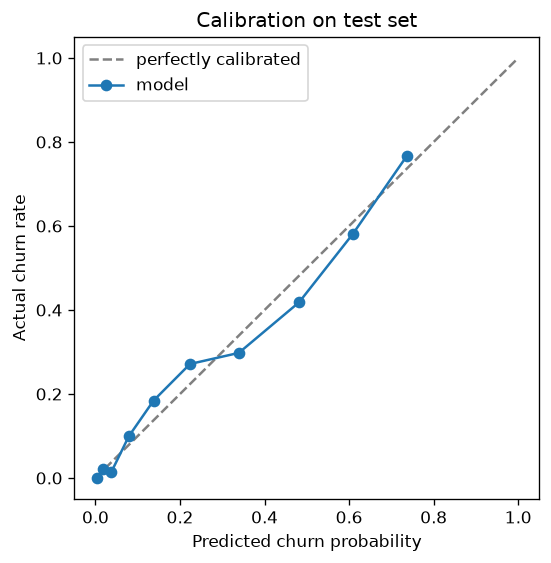
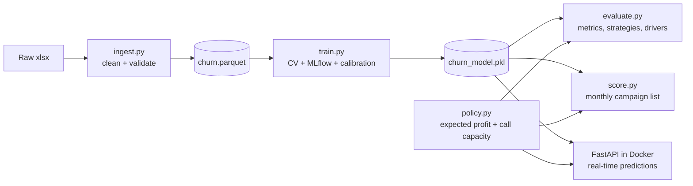

# Customer Churn Prediction Platform

An end-to-end machine learning platform that predicts which telecom customers are likely to churn and decides **whether to email them, call them, or do nothing**, based on expected profit.

It covers the full lifecycle: business framing, data validation, feature engineering, model selection with MLflow, probability calibration, a profit-based retention policy, batch scoring, and a Dockerized FastAPI service.

**Headline result:** on a held-out test set of 1,409 customers, the model-driven policy delivers **$36.3K in estimated net savings**. That is 16% more than emailing everyone, and 89% of what a perfect-foresight policy could achieve.

---

## Results

All numbers are on the held-out test set (20%, stratified), from [`reports/evaluation.json`](reports/evaluation.json).

| Metric | Model | Baseline |
|---|---|---|
| PR-AUC | **0.645** | 0.406 (rule: month-to-month contract) / 0.265 (random) |
| ROC-AUC | **0.849** | 0.500 (random) |
| Brier score | **0.136** | 0.195 (predict the churn rate for everyone) |
| Mean predicted churn | **0.267** | 0.265 (actual churn rate) |

**Retention campaign value** ([`reports/strategies.csv`](reports/strategies.csv)):

| Strategy | Emails | Calls | Net savings |
|---|---:|---:|---:|
| Do nothing | 0 | 0 | $0 |
| Rule: email month-to-month customers | 773 | 0 | $27,209 |
| Email everyone | 1,409 | 0 | $31,249 |
| **Model policy** | 1,132 | 42 | **$36,330** |
| Perfect foresight (upper bound) | 332 | 42 | $40,907 |

Savings are estimates based on assumed save rates (email 10%, call 30%) and costs (email $1, call $50), set in [`config/config.yaml`](config/config.yaml). Measuring the real save rates needs a control group (see [Roadmap](#roadmap)).



**Top churn drivers** (logistic regression odds ratios, [`reports/drivers.csv`](reports/drivers.csv)): having dependents (0.20×), longer tenure (0.30× per std), a two-year contract (0.47×) all reduce churn; a month-to-month contract (1.92×) and fiber optic internet (1.63×) increase it.

---

## Architecture



The same saved scikit-learn pipeline (feature engineering + preprocessing + model) and the same policy module are used for evaluation, batch scoring and the API, so the three can never disagree.

---

## Key design decisions

- **Leakage removed.** `churn_label`, `churn_score`, `churn_reason` and `cltv` are derived from the outcome or unavailable at prediction time, so they are dropped. Constant and high-cardinality geographic columns are dropped too.
- **PR-AUC for model selection.** With 26.5% churners, PR-AUC reflects how well the model ranks the minority class better than accuracy or ROC-AUC.
- **One-standard-error rule.** Logistic regression (0.679 ± 0.021 CV PR-AUC) was chosen over the slightly better engineered variant (0.681) and LightGBM (0.669): the simplest model within one standard deviation of the best, and fully explainable.
- **Calibrated probabilities.** `class_weight="balanced"` inflated predictions (mean 0.41 vs 0.27 actual). Sigmoid calibration fixed this (0.266), which matters because probabilities feed directly into expected-profit calculations.
- **Profit-based policy instead of a fixed threshold.** For each customer: expected profit = probability × save rate × 12 months of revenue − cost. The best action is chosen, and calls are limited to 3% of customers (team capacity), given to those where a call adds the most over an email.
- **Everything in a pipeline.** Column selection, feature engineering, scaling and one-hot encoding live inside one `Pipeline`, which prevents training/serving skew and makes input column order irrelevant.
- **Validated API contract.** Pydantic schemas accept only categories seen in training, reject unknown fields (including the label), and enforce cross-field rules (for example, internet add-ons require internet service).

Full business framing: [`docs/problem_framing.md`](docs/problem_framing.md).

---

## Project structure

```
├── api/                  FastAPI app (main.py) and request/response schemas
├── config/config.yaml    paths, features, CV, MLflow and business parameters
├── docs/                 problem framing
├── notebooks/            exploratory data analysis
├── reports/              evaluation outputs (metrics, strategies, drivers, calibration plot)
├── src/
│   ├── ingest.py         load, clean, validate raw data -> parquet
│   ├── features.py       engineered features + pipeline helpers
│   ├── train.py          CV model comparison, MLflow tracking, calibration
│   ├── evaluate.py       test metrics, campaign value, drivers
│   ├── policy.py         retention policy (shared by evaluate, score, API)
│   └── score.py          batch scoring -> campaign CSV + run summary
├── tests/                unit tests (features) and API tests
├── Dockerfile            serving image (requirements-api.txt only)
└── requirements.txt      pinned dependencies (full freeze in requirements-lock.txt)
```

---

## How to run

The dataset and the trained model are not committed, so run the pipeline once before starting the API.

**1. Set up the environment** (Python 3.13)

```bash
python -m venv .venv
.venv\Scripts\activate          # Windows; on macOS/Linux: source .venv/bin/activate
pip install -r requirements.txt
```

**2. Get the data.** Download the IBM Telco Customer Churn dataset (extended version, 33 columns) from [Kaggle](https://www.kaggle.com/datasets/yeanzc/telco-customer-churn-ibm-dataset) and save it as `data/raw/Telco_customer_churn.xlsx`.

**3. Run the pipeline**

```bash
python -m src.ingest       # clean + validate -> data/processed/churn.parquet
python -m src.train        # compare models, calibrate, save models/churn_model.pkl
python -m src.evaluate     # test metrics -> reports/
python -m src.score        # campaign list -> data/scored/
python -m pytest tests -v  # 23 tests
mlflow ui --backend-store-uri sqlite:///mlflow.db   # optional: browse experiments
```

**4. Serve the API**

```bash
uvicorn api.main:app --reload
# or with Docker:
docker build -t churn-api:1.0 .
docker run --rm -p 8000:8000 churn-api:1.0
```

Open http://localhost:8000/docs for interactive documentation.

| Endpoint | Description |
|---|---|
| `GET /health` | liveness check (used by the Docker `HEALTHCHECK`) |
| `GET /model/info` | model fingerprint, type and features |
| `POST /predict` | one customer -> probability, expected profits, action, risk reasons |
| `POST /predict/batch` | up to 1,000 customers |

Example response:

```json
{
  "customer_id": "DEMO-1",
  "churn_probability": 0.6603,
  "customer_value": 1020.0,
  "expected_profit_email": 66.35,
  "expected_profit_call": 152.05,
  "recommended_action": "call",
  "risk_reasons": ["tenure_months (low)", "contract = Month-to-month", "internet_service = Fiber optic"]
}
```

---

## Tech stack

Python · pandas · scikit-learn · LightGBM · MLflow · FastAPI · Pydantic · Docker · pytest

---

## Roadmap

- **Monitoring:** data and prediction drift reports with Evidently, comparing each scoring batch against the training data
- **Orchestration:** a monthly Prefect flow (ingest → score → monitor → retrain on trigger)
- **Measured impact:** a holdout control group to measure real save rates and replace the assumed ones
- **CI:** GitHub Actions running tests and the Docker build on every push
